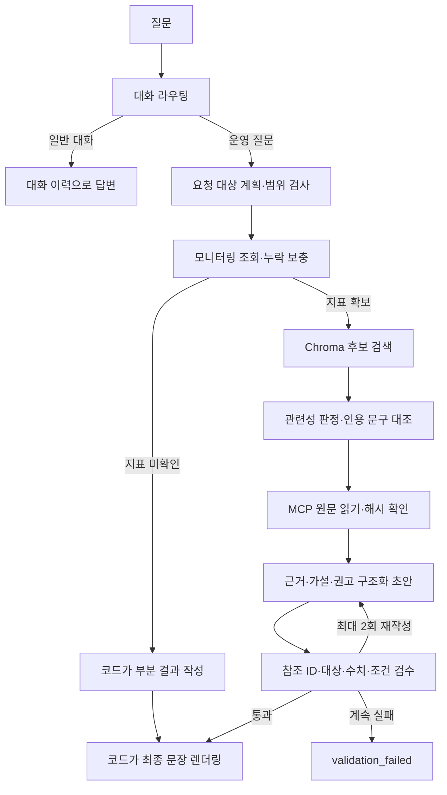

# 운영 인시던트 Agent — 런북 RAG·근거 및 조건 검수

현재 루트 폴더가 런북 RAG·근거 및 조건 검수를 적용한 개선본입니다. 이전 과제자료와 기존 Git 정보는 `기존과제자료_백업_20261020/`에 모았으며 Git 업로드 대상에서 제외합니다. 기존 GitHub 연결 주소와 개선본의 커밋 이력을 유지했습니다. 1~3단계 기준 커밋은 `4c5bf90`입니다. 사람 승인은 아직 구현하지 않았으며 실제 재시작·확장·롤백 도구도 없습니다.

## 10월 21일 토큰 최적화

OpenAI 보고서 생성은 이제 짧은 절차·가설 ID만 선택합니다. 현재 측정 사실, 권고 유형, 조건 표시, 출처와 실행 여부는 코드가 구성하고 기존 검수기로 다시 검사합니다. 입력에서 문서 메타데이터·가설 반복을 없애고 동일한 가설/알림의 중복 표시를 정리했습니다. 별도 모델의 미사용 분석 요약은 현재값의 코드 비교로 대체했으며 공통 원인은 확정하지 않습니다. Ollama의 기존 전체 보고서 방식은 유지합니다.

최적화 전 개선본은 `baseline/pre-token-optimization-20261021`(`f369c8f`)에 보존했습니다. 원본·개선본·최적화본의 고정 샘플 비교 방법과 한계는 [최적화 설명](doc/token_optimization.md)을 참고하세요. 이전 `evidence/rag_validation`은 10월 20일의 역사 기록이며 새 실측으로 덮어쓰지 않습니다.

2026-10-21에 같은 고정 샘플로 총 99건을 실행했습니다. 평균 시간은 기존 개선본 5.392초에서 최적화본 2.885초로, 장애 24건의 핵심 토큰은 126,367개에서 34,582개로 감소했습니다. [세 버전 비교표](doc/three_way_comparison.md) · [집계 CSV](doc/three_way_comparison.csv). 검색 캐시를 재사용한 조건이며 최종 답변의 독립적인 의미 검수는 남아 있습니다.

## 현재 실행 화면

브라우저: **http://127.0.0.1:18620** · 백엔드: **http://127.0.0.1:18120**

이미 이 포트에서 실행 중이면 다시 서버를 띄우지 않습니다. 이전 1~3단계 화면은 18610입니다. 새 기능 검증에는 18620을 사용합니다.

## 환경 준비와 실행

현재 컴퓨터에는 `.venv-rag` 전용 환경을 준비했습니다. `.venv`도 이 개선본 환경을 가리킵니다. 기존 과제의 가상환경과 설정은 백업 폴더에 보존했고, 실행용 `.env`는 루트에 유지했습니다. 이전 절대 경로를 사용하는 도구를 위해 Documents/Codex의 옛 작업 경로에는 현재 루트로 연결되는 호환용 바로가기만 유지합니다. ZIP에는 가상환경·키·대화 DB·검색 캐시가 없습니다.

다른 컴퓨터에서는 Python 3.11과 uv를 준비하고 다음을 실행합니다.

```bash
uv venv --python 3.11 .venv-rag
uv pip install --python .venv-rag/bin/python -r requirements-rag.lock.txt
cp .env.example .env
```

`.env`의 OPENAI_API_KEY를 본인 키로 채웁니다. 키는 출력하거나 코드에 넣지 않습니다. LangSmith 기록이 필요하면 본인 키와 tracing 설정도 추가합니다. 임베딩·관련성 판정·답변 생성은 OpenAI API를 사용하므로 실제 API 사용량이 발생합니다. 추가 검색 API나 OpenAI Python SDK는 사용하지 않고 기존 httpx REST 방식을 유지했습니다.

두 터미널에서 각각 실행합니다.

```bash
.venv-rag/bin/python tools/run_local.py backend
```

```bash
.venv-rag/bin/python tools/run_local.py frontend
```

서버는 종료할 때 해당 터미널에서 Ctrl+C를 사용합니다. 기존 서버를 강제 종료하거나 session.db를 지우는 스크립트는 사용하지 않습니다. 새 실행은 `session.db.rag`에 대화를 저장합니다.

## 어떻게 처리하나요?



### 검색

- 수업 런북 6개를 전체 문서 단위로 로컬 Chroma에 저장합니다. `text-embedding-3-small`로 문서와 질문을 변환합니다.
- 원문 해시·임베딩 모델·인덱스 버전을 보관합니다. 변경 없는 문서와 같은 질문의 임베딩은 재사용합니다.
- 서비스별 알림과 전체 질문을 나눠 검색해 한 서비스의 증상이 다른 서비스를 덮지 않게 합니다.
- 벡터 상위 3개 후보에서 `gpt-4o`(기본 관련성 모델)가 직접 관련된 문서를 고릅니다. 질문·문서의 인용 문구가 실제 원문에 있는지 코드로 대조합니다. 인용 존재가 의미적 관련성을 완전히 증명하는 것은 아닙니다.
- 전체 최대 2개를 읽으며 관련 없는 문서로 두 개를 채우지 않습니다. 결과 없음·검색 오류는 한 번 더 검색하고, 여전히 부족하면 상태를 명시합니다.
- 최종 원문은 기존 MCP Resource로 읽고 등록된 ID·내용 해시를 검사합니다. 원문 읽기 실패와 조건표 해시 불일치도 정상 규정으로 취급하지 않습니다.
- `data/retrieval_policy.json`의 거리 임계값은 초기 거리 단독 실험 기록입니다. 현재는 상위 후보 순위와 관련성 판정·인용 검사를 사용합니다. 이를 정답 확률로 해석하지 않습니다.

### 근거와 검수

- 현재 조회 상태·CPU·메모리와 알림 원문을 서로 다른 근거 ID로 저장합니다. 알림 발생 시각이 없으면 미확인으로 남깁니다.
- OpenAI 초안은 절차·가설의 짧은 ID만 반환하며 코드가 사실 참조와 권고 유형을 채웁니다. 임의 사실·수치·자유문장 answer 필드는 허용하지 않습니다.
- 코드가 서비스명·수치·상태·근거 ID·권고의 적용 조건을 검사합니다. 최종 문장은 검증된 참조와 신뢰한 원문에서 렌더링하므로 별도 자유문장 재생성에서 숫자가 다시 바뀌지 않습니다.
- CPU 90% 초과와 높은 상태의 지속은 별도 조건입니다. 현재 단일 조회로 지속을 입증할 수 없습니다. 알림에서 추출한 풀·디스크 수치는 현재 측정값으로 간주하지 않아 현재값 조건을 자동 충족시키지 않습니다.
- 조건은 충족·미충족·확인불가입니다. 미충족/확인불가 조건을 포함한 조치는 조건부 권고만 허용합니다. 수업 런북의 90% 기준은 실제 모든 서비스에 적용되는 보편 기준이 아닙니다.
- 최초 초안 뒤 최대 2회 재작성합니다. 계속 실패하면 강제 통과하지 않습니다. 장애 초안은 검수 전에 화면에 보내지 않습니다.

## API 변경

POST `/chat` 입력은 기존 message/thread_id/request_id를 유지합니다. 응답에 status를 추가했습니다.

| status | 의미 |
|---|---|
| success | 보고서 처리 성공입니다. 원인 확정·복구 성공이라는 뜻은 아닙니다. |
| partial | 일부 모니터링 지표를 확보하지 못해 부분 결과만 제공합니다. |
| validation_failed | 초안의 참조·조건 검수가 끝까지 실패해 권고를 확정하지 않습니다. |

metadata에는 validation_result, runbook_ids, runbook_search_status, search_count, 근거 목록, 검색 사용량이 있습니다. 검수 실패는 HTTP 오류와 구분한 처리 상태이며 실패 초안을 성공 답변 이력으로 저장하지 않습니다.

GET `/chat/stream`은 요청 ID가 붙은 SSE를 유지합니다. 검색/원문/검수 진행 이벤트를 추가했습니다. 검수 실패는 `ValidationFailed`로 알리고 `FinalAnswer`/`Finalize` 성공 이벤트를 내보내지 않습니다. `[DONE]`은 스트림 종료를 뜻하며 성공 판정이 아닙니다.

## 검사와 자료

```bash
LANGSMITH_TRACING=false LANGCHAIN_TRACING_V2=false .venv-rag/bin/python -m unittest discover -s tests -v
node --test tests/test_request_ui.cjs
```

자동 테스트는 통제된 벡터·모델·도구를 사용합니다. 실제 임베딩·실제 모델 결과는 [검증 보고서](evidence/rag_validation/report.html)에 따로 정리합니다. 비용의 cost_usd는 기존 가상 단가 값이며 청구액이 아닙니다. 검색 API 사용량은 따로 기록합니다.

검색만 재평가하려면 다음 명령을 사용합니다. 이 명령은 OpenAI API를 호출합니다.

```bash
.venv-rag/bin/python tools/evaluate_runbooks.py --rerank
.venv-rag/bin/python tools/evaluate_runbooks.py --rerank --heldout
```

평가 질문과 기대 ID는 `data/retrieval_cases.json`에 있습니다. 개발 도중 여러 방식으로 재검사했으므로 독립적인 최종 성능 평가로 보지 않습니다. 원문 해석과 최종 답변의 별도 사람 검수는 남아 있습니다. 문서를 변경하면 검색 정책을 재평가하고 `runbook_rules.json`의 조건·원문 해시도 검토해야 합니다.

## 주요 파일

| 파일 | 역할 |
|---|---|
| agent/runbook_retriever.py · embeddings.py · relevance.py | 캐시·Chroma 후보·관련성 판정·인용 대조 |
| agent/evidence.py | 근거 ID와 출처 구분 |
| data/runbook_rules.json · agent/validator.py | 원문과 연결한 조건표·검수 |
| agent/grounded_report.py | 출력 스키마와 최종 문장 렌더링 |
| agent/graph.py | 검색·근거·재작성·실패 종료 연결 |
| server.py · web_chat.html · request_ui.js | POST/SSE 상태와 화면 |

## 한계

검색 관련성은 모델 판단을 포함하므로 문서 누락·오선택 가능성이 남습니다. 자동 검수는 구조화 참조와 등록된 조건을 검사하며 모든 자연어 의미를 이해하는 범용 사실 검증기가 아닙니다. 모니터링은 임의 변동이 있는 수업 샘플이고 시계열·배포 로그·프로파일링 도구는 없습니다. 사람 승인과 실제 외부 조치는 이번 범위 밖입니다. 기존 미지원 billing-service의 auth-service 폴백 정책과 일반 대화 경로는 유지했습니다. 단일 프로세스의 요청 잠금·검색 잠금이며 다중 worker 운영은 검증하지 않았습니다.

공식 기술 참고: [Chroma query](https://docs.trychroma.com/docs/querying-collections/query-and-get), [Chroma configuration](https://docs.trychroma.com/docs/collections/configure), [OpenAI embeddings](https://developers.openai.com/api/docs/guides/embeddings), [OpenAI Structured Outputs](https://developers.openai.com/api/docs/guides/structured-outputs?api-mode=chat).
