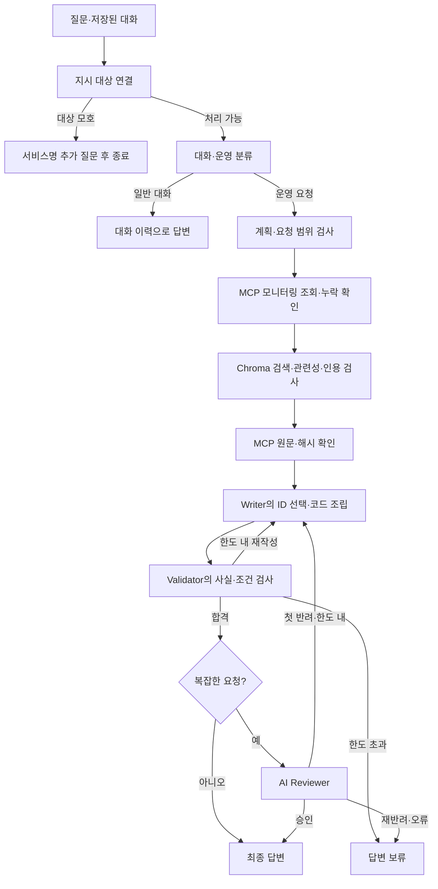

# 운영 인시던트 Agent 개선 프로젝트

현재 루트가 제출용 개선본입니다. 원본은 `기존과제자료_백업_20261020/`에 보존했으며 수정하지 않았습니다. 기존 GitHub 연결을 유지합니다. 사용 자료는 **수업용 모니터링 샘플과 런북 6개**입니다. 실제 서비스 장애를 분석하거나 조치를 실행하는 서비스는 아닙니다.

## 원본 대비 실제 변경

원본 `0d8405e`와 최종 제품 `69d58eb`를 비교합니다. [19개 기능의 원본 확인표](doc/original_final_feature_audit.md)에 코드 근거를 연결했습니다.

- 원본에도 복수 서비스 계획·대상 이름 보정이 있었습니다. 최종본은 요청 대상 전체를 대조하고 **부분 누락과 실제 조회 결과의 유효성**까지 검사합니다.
- 원본도 MCP로 런북을 읽고 답변에 사용했습니다. 최종본은 첫 키워드 유형 선택을 **증상별 Chroma RAG·관련성·인용·원문 대조**로 바꿨습니다.
- 원본의 자유문장 작성·형식 검사를 **ID 선택·Python 사실 조립·근거와 조건 검수**로 강화했습니다. 복잡한 요청에는 별도 AI Reviewer를 추가했습니다.
- 원본의 SQLite 대화 저장을 유지하면서 **운영 후속 질문의 대상 연결·모호성 확인·새 지표 조회**를 보완했습니다. 요청 ID와 대화 쌍 저장으로 표시·저장 경계도 보완했습니다.
- 원본에도 Writer 최대 3회 제한이 있었습니다. 최종본은 계속 실패하면 강제 합격시키지 않고 보류하며 Reviewer도 최대 2회로 제한합니다.

FastAPI lifespan, MCP 별도 stdio 프로세스, DI, LangGraph·LangSmith, 병렬 조회·일시 오류 재시도는 기존 기반입니다. 이 기술들을 처음 구현했다고 소개하지 않습니다. [초보자를 위한 코드 설명](doc/final_code_guide.md).

## 제출자가 먼저 볼 자료

**3반 G092 이정인 / 과제 1**

1. [제출용 보고서 PDF](output/pdf/AI_Agent_개선보고서_3반_G092_이정인.pdf) · [보고서 원문](doc/report.md)
2. [5분 발표 PPT](output/AI_Agent_개선_최종발표.pptx) · [2분·3분 발표문](doc/presentation_script.md)
3. [핵심 코드 설명](doc/final_code_guide.md) · [원본 기능 대조](doc/original_final_feature_audit.md)
4. [동일 입력 실측 전체 표](doc/final_comparison.md) · [CSV](doc/evidence/final_comparison.csv)

최종 증빙은 `doc/evidence/`, 실제 실행 캡처는 `doc/assets/`에 정리했습니다. 원시 실행 자료와 원본 백업은 보존했습니다. 자동 처리·검수 통과는 독립 평가자의 정답률이 아니며 실제 청구액은 미측정입니다.

## 실행 방법

Python 3.11과 uv를 준비한 뒤 다음을 실행합니다. 이미 `.venv-rag`가 있다면 다시 만들 필요가 없습니다.

```bash
uv venv --python 3.11 .venv-rag
uv pip install --python .venv-rag/bin/python -r requirements-rag.lock.txt
cp .env.example .env
```

`.env`의 `OPENAI_API_KEY`를 본인 키로 채웁니다. LangSmith를 사용하려면 본인 설정을 추가합니다. 키를 코드·발표·로그에 적거나 출력하지 않습니다. 실제 OpenAI 호출은 과금되며 추가 유료 검색 API는 사용하지 않습니다.

서로 다른 터미널에서 실행합니다.

```bash
.venv-rag/bin/python tools/run_local.py backend
```

```bash
.venv-rag/bin/python tools/run_local.py frontend
```

기본 화면은 `http://127.0.0.1:18620`, 백엔드는 `http://127.0.0.1:18120`입니다. 이미 실행 중인 서버에는 코드 변경이 자동 반영되지 않을 수 있으므로 그 서버를 실행한 터미널에서 Ctrl+C로 종료한 뒤 다시 실행합니다. 다른 프로그램을 강제 종료하거나 대화 DB를 지우지 않습니다. 세션은 `session.db.rag`에 저장합니다.

## 처리 흐름



### 검색·기억·검수의 경계

- 여섯 짧은 런북을 전체 문서 단위로 저장합니다. `text-embedding-3-small` 임베딩과 Chroma를 사용합니다. 관련성 필터에 현재 전체 여섯 후보를 주며 질문·문서 인용이 원문에 있는지 대조합니다. 문서가 늘 때의 토큰 예산 제어는 향후 과제입니다.
- 문서·질문 임베딩과 관련성 판정을 캐시로 재사용합니다. 원문 해시는 내용 일치만 확인하며 정답·최신성을 보장하지 않습니다.
- `request_context.py`는 최근 대화 10개 메시지에서 **사용자가 명시한 서비스 이름**을 확인합니다. 등록된 한국어 지시 표현만 처리하며 일반적인 대명사 해석 전체를 구현하지는 않았습니다. 새 서비스명을 명시하면 그 이름을 우선합니다.
- 현재 관측값, 알림 인용, 원인 가설, 조건부 권고를 구분합니다. CPU가 높다는 한 번의 값으로 지속 시간이나 배포 원인을 확정하지 않습니다.
- 일반 대화의 실제 생성 조각은 `messages`, 노드 완료 상태는 `updates`, 코드가 직접 호출하는 MCP 작업의 시작·완료는 `custom`으로 구분합니다. 검수 전 장애 초안은 공개하지 않습니다. 스트리밍 전용 검증은 추가하지 않았습니다.

## API 상태

POST `/chat` 입력은 `message`, `thread_id`, `request_id`를 사용합니다. GET `/chat/stream`은 같은 요청 ID가 붙은 SSE를 사용합니다. `[DONE]`은 스트림 종료이며 성공 판정이 아닙니다.

| status | 의미 |
|---|---|
| `success` | 보고서 처리 완료입니다. 원인 확정·복구 완료를 뜻하지 않습니다. |
| `clarification_required` | 지시 대상이 모호해 서비스 이름을 추가 질문합니다. 조회하지 않습니다. |
| `partial` | 일부 지표를 얻지 못해 확인한 범위만 제공합니다. |
| `validation_failed` | 사실·조건 검수를 끝까지 통과하지 못했습니다. |
| `review_failed` | AI Reviewer가 재반려했거나 검토 오류가 발생했습니다. |

응답 메타데이터의 `effective_query`·`context_resolution`으로 대상 연결을 확인할 수 있습니다. 서비스명·조회 근거·검색 결과·검수 상태도 분리해서 기록합니다. 실패 초안을 성공 답변으로 저장하지 않습니다.

## 검사·실측 재현

```bash
LANGSMITH_TRACING=false LANGCHAIN_TRACING_V2=false .venv-rag/bin/python -m unittest discover -s tests -v
node --test tests/test_request_ui.cjs
```

자동 검사는 통제된 모델·도구를 사용합니다. 실제 API 비교는 별도 실행입니다. 기존 측정 폴더를 덮어쓰지 않도록 새 경로와 프로젝트 접두어를 정합니다.

```bash
.venv-rag/bin/python tools/benchmark_reviewer_comparison.py --latest-ref 69d58eb --out evidence/new_comparison --trace-prefix capstone-new-comparison --warm-cache --extra-cases data/final_feature_cases.json
```

원본 비교 입력은 `data/baseline_cases.json`에, 이번 새 기능 입력은 `data/final_feature_cases.json`에 있습니다. 원시 `evidence/`는 Git 제외 대상이며 제출용 작은 집계·예시는 `doc/`에 보관합니다. 새로 준비한 Git 사본에서는 원본 커밋 `0d8405e`를 포함한 전체 이력이 필요합니다. 로컬 원본 백업이 없으면 그 커밋에서 소스를 읽으며, 검색 인덱스가 없으면 시작 과정에서 생성합니다. 인덱스 생성 비용은 본 비교에서 제외됩니다. 보고서 작성 도구 `tools/report_final_alignment.py`는 이번 최종 실측 폴더 전용입니다.

## 남은 한계

`billing-service`는 지원 목록에 없으며 기존 `auth-service` 대체 정책을 유지합니다. 이를 billing-service 조사 성공으로 해석하지 않습니다. 검색·Reviewer도 모델 판단 오류가 남고, 문서 인용 존재만으로 관련성 전체를 증명할 수 없습니다. 샘플에 시계열·배포 이력·실제 호출 관계가 없어 근본 원인은 확정할 수 없습니다. 사람 승인, 운영 조치 실행, 다중 worker 운영 검증은 구현하지 않았습니다.
