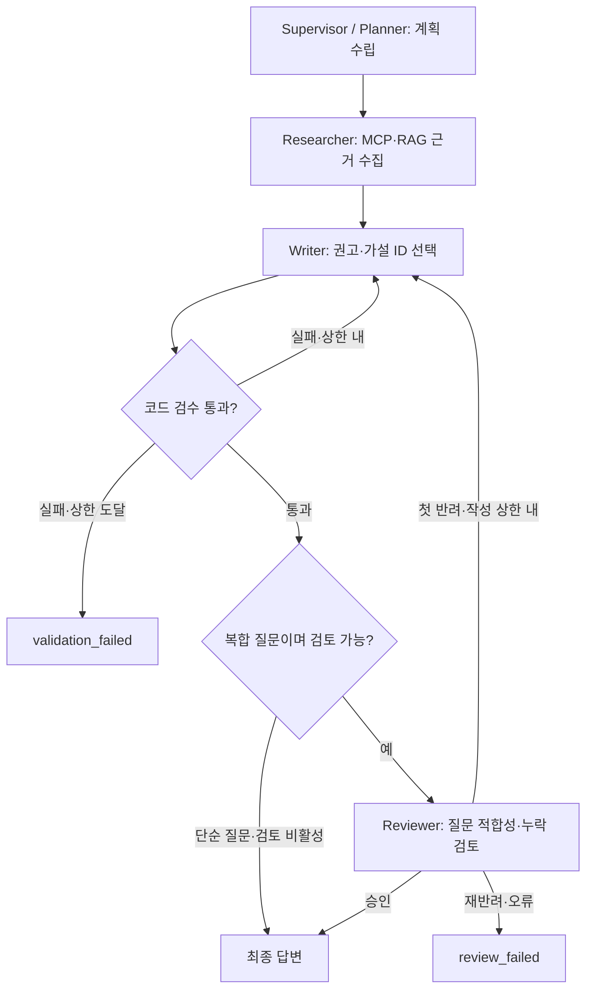

# 선택적 Reviewer Agent

교재의 역할별 프롬프트·위임·피드백 구조를 현재 Supervisor에 적용했습니다. Planner는 조사 계획, Researcher 경로는 MCP/RAG 수집과 관련성 판정, Writer는 허용된 권고·가설 선택, Reviewer는 검수된 초안의 질문 적합성 검토를 담당합니다. 각 노드가 모두 LLM Agent인 것은 아니며, 수치·근거·조건 검사는 코드가 담당합니다.

## 실행 흐름



일반 대화는 기존 대화 경로를 사용합니다. 모니터링 미확인·런북 근거 없음에는 검토를 생략하고 기존의 부분 결과/자료 부족 안내를 유지합니다. 생략은 승인으로 기록하지 않습니다.

## 호출 조건

코드 검수를 통과하고 사용 가능한 절차가 있는 요청 중 다음 하나에 해당하면 실행합니다.

- 요청 서비스가 두 개 이상
- 참조 런북이 두 개 이상
- 계획에서 비교 분석이 필요하다고 판단

`OpenAIReviewer`는 Writer와 별도 객체·시스템 프롬프트를 사용하며, 기본 모델은 기존 품질 모델과 같습니다. 모델이 서로 달라야 역할 분담이 성립하는 것은 아닙니다. 수업의 Worker 예제처럼 역할과 출력 계약으로 분리합니다.

## 권한과 실패 처리

- 입력: 질문, 현재 근거, 허용 절차, 코드 검수를 통과한 초안, 요청 대상.
- 출력: `approved`와 최대 4개의 구조화된 수정 의견. 의견은 정해진 오류 코드·알려진 대상·허용된 절차 ID만 참조합니다.
- 검토 대상: 요청 대상/답변 누락, 무관한 권고, 비교 요청 미응답, 원인 단정, 한계 설명 누락.
- 사실·수치·최종 답변을 새로 작성하거나, 도구를 실행하거나, 코드 검수 실패를 덮어쓸 권한이 없습니다.
- Reviewer는 최대 2회, Writer는 기존대로 총 3회입니다. 첫 반려 후 수정한 초안도 코드 검수를 다시 통과해야 합니다.
- 검토 오류·재반려는 `review_failed`입니다. API는 실패 안내를 반환하고 성공 답변으로 대화 DB에 저장하지 않습니다. 화면도 `ReviewerFailed`를 최종 실패로 처리합니다.
- Reviewer 승인과 실제 원인 확인·현장 조치 실행·사람 승인은 서로 다릅니다. HITL은 이번 기능이 아닙니다.

## 설정

```dotenv
REVIEWER_MODE=conditional
OPENAI_REVIEWER_MODEL=gpt-4o
```

OpenAI 백엔드에서 기본 활성화됩니다. `REVIEWER_MODE=off`로 끌 수 있고 fake/Ollama에서는 비활성 상태로 표시합니다. 실제 `.env`의 키는 코드나 문서에 넣지 않습니다.

API metadata에는 `review_status`, `review_attempts`, `review_result`가 추가됩니다. 화면에는 Reviewer 시작·승인·수정 요청·오류가 표시됩니다. 초안/검토 JSON은 답변 텍스트로 스트리밍하지 않습니다.

## 확인 범위

Reviewer의 조건부 실행, 반려 후 환류, 횟수 상한, 잘못된 검토 응답, 코드 검수 우회 방지, 실패 답변 미저장을 검사합니다. 새 스트리밍 전용 테스트·첫 토큰 지표는 추가하지 않습니다.

이전 99건 비교는 Reviewer 추가 전인 `8e455e8` 계열의 기록입니다. 새 Reviewer의 비용·품질·지연 개선을 그 수치로 주장하지 않습니다. Reviewer를 실제 호출한 요청에는 추가 토큰·시간이 발생할 수 있으며, 승인도 내용의 완전한 정확성을 보장하지는 않습니다.
