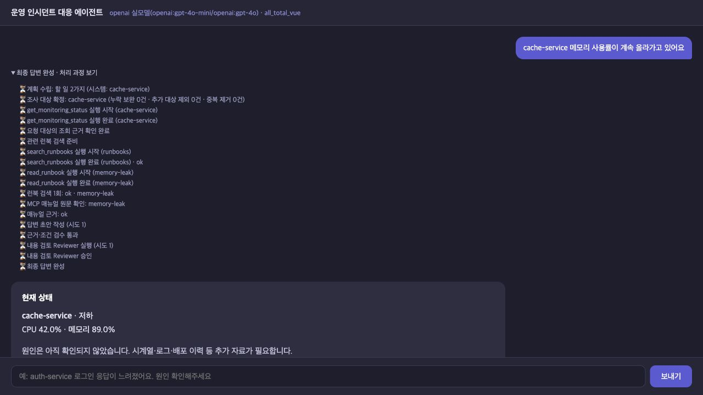
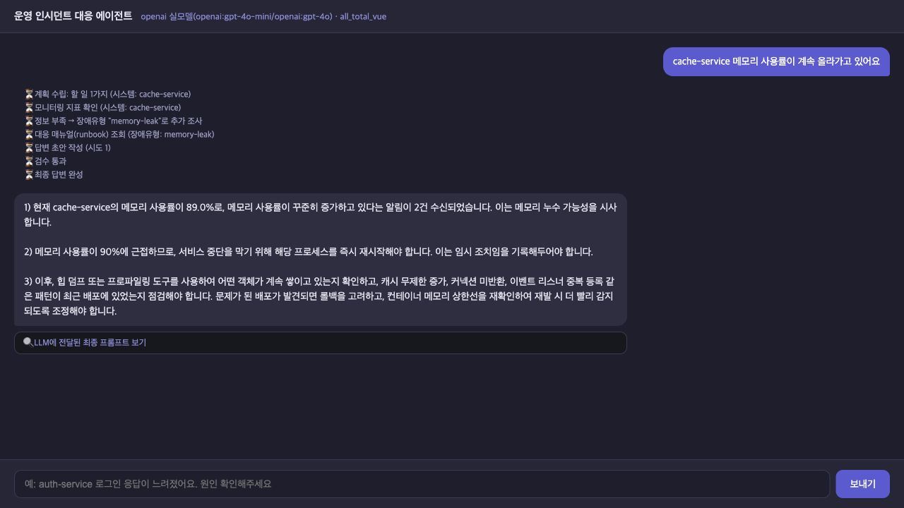
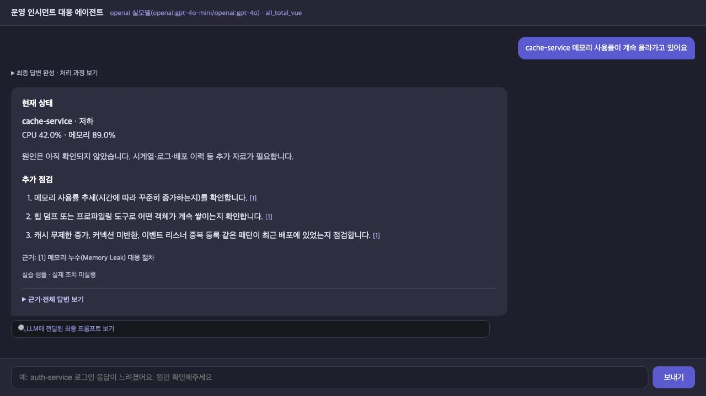

**3반 G092 이정인**

# AI 서비스 Mini-Project 개선 보고서

과제 1 · Base AI Project 개선하기
운영 인시던트 대응 Agent의 조사 범위·런북 검색·답변 검수 개선
작성일: 2026년 10월 21일

## 1. 진행 사항 소개

### 선택 과제와 목표

기존 운영 인시던트 대응 Agent를 개선했습니다. 사용자가 서비스의 이상 증상을 질문하면 수업용 모니터링 자료와 대응 매뉴얼인 런북을 조회하고, 확인한 사실과 조건에 맞는 대응 안내를 제공합니다. 실제 운영 장애를 진단하거나 재시작·확장·롤백을 실행하는 시스템은 아닙니다.

이번 목표는 **요청한 대상을 빠뜨리지 않고 조사하고, 관련 런북을 연결하며, 근거보다 강하게 단정하는 답변을 줄이는 것**입니다. 기존 과제의 코드와 최종 제품 코드를 직접 대조한 뒤 실제 변경을 정리했습니다.

| 추가·수정 task | 변경 내용 | 완료 범위 |
|---|---|---|
| 조사 대상 검사 | 전체 요청 대상과 계획·실제 조회값을 대조합니다. | 부분 누락 보완, 지표 유효성 검사, 미확인 표시 |
| 런북 RAG | 첫 키워드 유형 선택을 증상별 의미 검색으로 바꿨습니다. | Chroma·관련성 판정·인용·MCP 원문 대조 |
| 답변 근거 검수 | Writer의 선택과 사실·조건 구성을 분리했습니다. | ID 선택, Python 조립, 근거·조건 Validator |
| 별도 AI Reviewer | 복잡한 요청의 누락과 원인 단정을 다시 검토합니다. | 조건부 검토, 제한된 재작성, 실패 시 보류 |
| 대화·출력 보완 | 운영 후속 질문의 대상과 화면 이벤트를 구분합니다. | 모호하면 추가 질문, 새 지표 조회, 요청 ID 구분 |

### 원본에 이미 있었던 기반

MCP, LangGraph, FastAPI lifespan, 의존성 주입, LangSmith, 복수 서비스 계획, SQLite 대화 저장, 병렬 조회와 재시도는 원본에도 있었습니다. 이 기술을 처음 도입한 것으로 소개하지 않습니다. 원본도 런북을 읽어 답변에 사용했습니다. 이번에는 **어떤 런북을 고르고, 근거를 답변에 어떻게 연결하고 검사할지**를 보완했습니다.

비교 대상: 원본 `0d8405e`, 실측 제품 `69d58eb`. 최신 화면 `f2e26e1`은 본문을 간결하게 표시하고 원문을 접습니다. 모델 입력·API 답변·검수 로직은 동일하며, 화면 변경의 성능을 새로 측정한 것은 아닙니다.

<!-- pagebreak -->
## 2. 사용한 기술 요소

기술은 필요한 동작에 연결했습니다. 예를 들어 MCP는 자료를 읽는 통로이고, RAG는 질문에 맞는 자료를 찾는 방식이며, LangGraph는 처리 순서와 분기를 관리합니다.

| 기술 요소 | 사용 목적과 실제 반영 내용 | 원본 대비 구분 |
|---|---|---|
| Multi-Agent | 기존 계획·조사·작성 역할에 별도 지시문과 출력 계약의 Reviewer 역할을 연결했습니다. | 역할 분리는 기존 기반, Reviewer 추가 |
| MCP | Tool로 모니터링을 조회하고 Resource로 선택한 런북 원문을 읽습니다. Prompt도 기존 계획에서 사용합니다. | 기존 stdio 클라이언트 유지 |
| RAG·Chroma | 질문과 서비스별 알림을 벡터로 검색하고 관련 런북을 답변 근거로 제공합니다. | 검색기·임베딩·관련성 필터 추가 |
| 의존성 주입 | `SupervisorDeps`를 통해 모델·MCP·검색기·Reviewer를 노드에 전달합니다. | 기존 방식에 의존성 추가 |
| LangSmith | 노드·모델·MCP 실행 흐름을 추적하고 실제 Run과 사용량 기록을 대조합니다. | 기존 추적을 새 노드에도 적용 |
| 모듈화 | 대상 검사, 검색, 근거 구성, ID 선택, 검수와 검토의 책임을 나눴습니다. | 기능별 모듈 보완 |
| 단위·회귀 검사 | 통제된 모델·도구로 실패 조건을 검사하고 실제 API 실행과 구분했습니다. | 최신 Python 90개·화면 11개, 실측 당시 화면 5개 |

### 전체 처리 순서

1. 저장된 사용자 대화에서 운영 질문의 지시 대상을 확인합니다. 모호하면 서비스 이름을 되묻고 종료합니다.
2. 운영 요청이면 계획을 만들고 전체 요청 대상과 대조합니다. MCP 조회 후 실제 지표가 부족한 대상만 한 차례 보충합니다.
3. 질문·알림에 맞는 런북을 검색하고 MCP로 원문을 읽어 대조합니다.
4. Writer가 절차·가설 ID를 고릅니다. Python이 사실·조건·출처를 조립하고 Validator가 검사합니다.
5. 복수 서비스·복수 런북·비교 요청처럼 복잡한 경우만 Reviewer가 검토합니다. 통과하면 공개하고 계속 실패하면 보류합니다.

모든 노드가 독립적인 Agent인 것은 아닙니다. 대상·수치·참조 검사는 Python이 수행하고, 관련성·절차 선택·내용 검토에는 모델 판단을 사용합니다. AI Reviewer는 사람 승인(HITL)이 아닙니다.

<!-- pagebreak -->
## 2-1. 신규·추가 코드: Agent Graph와 MCP

### Graph는 작업 순서와 갈림길을 정합니다

`agent/graph.py`의 `build_graph()`는 노드 함수를 등록하고 연결한 뒤 실행 가능한 그래프로 컴파일합니다. 노드는 한 단계의 작업이며, State는 그 단계들이 공유하는 질문·조사 결과·검수 상태입니다.

```python
g.add_edge("research", "replan_check")
g.add_conditional_edges("replan_check", _after_replan_check,
    {"analysis": "analysis", "research": "research",
     "retrieve_runbooks": "retrieve_runbooks"})
g.add_edge("retrieve_runbooks", "analysis")
g.add_edge("write", "validate")
g.add_conditional_edges("validate", _after_validate,
    {"review": "review", "write": "write",
     "validation_failed": "validation_failed"})
```

위 코드는 실제 `build_graph()`에서 발췌했습니다. 조사 후 정보가 부족하면 조사로 돌아가고, 런북 검색이 필요하면 검색 노드로 이동합니다. 작성 뒤에는 검수 결과에 따라 검토·재작성·보류 경로를 선택합니다. 단순히 모델을 반복 호출하는 것보다 종료 조건을 코드에서 확인하기 쉽습니다.

### 기존 MCP 통로에 검색 결과를 연결했습니다

`retrieve_runbooks_node()`는 검색기가 고른 런북 ID로 MCP Resource 원문을 읽습니다. MCP 클라이언트 자체는 원본과 같은 파일을 사용합니다. 새 HTTP 서비스로 분리했다고 설명하지 않습니다.

```python
resource_server, template = await deps.mcp.find_resource_template(
    'get_incident_runbook')
text = await deps.mcp.read_resource(
    template.format(incident_type=key), server=resource_server)
```

이 코드는 실제 호출부를 줄바꿈해 발췌했습니다. `key`는 등록된 런북 ID입니다. 읽은 내용의 해시가 검색 카탈로그·선택 결과의 해시와 일치하는지 검사합니다. 해시는 문서 내용이 바뀌지 않았는지 확인하는 값이며, 문서의 최신성이나 권고의 정확성을 보장하는 점수는 아닙니다.

모니터링은 기존 `get_monitoring_status` Tool로 읽습니다. 반환 서비스명과 상태, 유효한 CPU·메모리, 알림 목록을 검사한 뒤 근거로 사용합니다. 현재 p95·커넥션 풀·시계열·로그·배포 이력은 직접 조회하지 않습니다. 런북의 추가 점검은 별도 자료가 필요한 항목이며 수행 완료를 뜻하지 않습니다. 운영 조치를 실행하는 Tool은 없습니다.

<!-- pagebreak -->
## 2-2. 신규·추가 코드: RAG와 답변 검수

### 관련 런북을 검색합니다

원본은 알림을 합쳐 키워드를 순서대로 검사하고 처음 맞는 유형 하나를 선택했습니다. 최종본은 `RunbookRetriever.search()`에서 서비스별 알림과 전체 질문을 각각 검색 문장으로 만듭니다. 특정 서비스의 CPU 표현이 다른 서비스의 메모리 증상을 덮지 않도록 분리했습니다.

```python
vectors = self._embed([text for _, text in queries], 'query')
result = self.collection.query(
    query_embeddings=vectors, n_results=len(self.catalog),
    ids=list(self.catalog), include=['metadatas', 'distances'])
```

실제 검색 코드의 줄바꿈을 정리한 발췌입니다. `text-embedding-3-small`이 문장을 숫자 벡터로 바꾸고 Chroma가 가까운 문서를 찾습니다. 현재 자료는 짧은 런북 여섯 개여서 문서 전체를 단위로 저장합니다. 관련성 모델에는 현재 전체 후보를 주며, 모델이 고른 질문·문서 인용이 실제 원문에 있는지 Python이 확인합니다. 선택한 ID의 MCP 원문과 조건표까지 대조한 뒤 사용합니다.

검색은 최대 두 차례 시도합니다. 검색 실패·자료 없음·원문 불일치를 구분하고, 빈 결과를 정상적인 권고로 만들지 않습니다. 최종본의 별도 F08 실행에서는 CPU·메모리·디스크 런북 세 개를 확인했습니다. 이 사례는 최종본 동작 확인이며 전후 검색 정답률 실험은 아닙니다.

### 모델의 선택과 코드의 사실 구성을 나눴습니다

```python
class ReportSelection(StrictModel):
    action_ids: list[str]
    hypothesis_ids: list[str]
```

Writer 모델은 허용된 절차와 가설 ID만 고릅니다. `expand_selection()`은 없는 ID를 거부하고 실제 조회값·적용 조건·출처·제안 상태를 조립합니다. `validate_report()`는 서비스명·수치·참조·필수 사실·조건을 검사합니다. 알림의 숫자는 현재 측정값과 구분하고, 확인하지 않은 원인은 가설로 표시합니다.

코드 검수 후 복잡한 요청에는 `review_policy()`가 Reviewer를 붙입니다. Reviewer는 대상 누락·관련 없는 절차·비교 미응답·원인 단정 등을 읽기만 하고 판정합니다. Writer는 최초 포함 최대 3회, Reviewer는 최대 2회이며 계속 실패하면 보류합니다. 원본에도 작성 한도가 있었지만 마지막 실패를 강제 통과시켰다는 차이가 있습니다.

<!-- pagebreak -->
## 3. 구현 기능 화면 캡처

### 조회·검색·원문 확인·검수의 연결

입력: **“cache-service 메모리 사용률이 계속 올라가고 있어요”**



그림 1. 최신 화면을 실제 OpenAI 모드로 실행하고 ‘처리 과정 보기’를 펼쳤습니다. 요청 대상 확인, 모니터링, 런북 검색, MCP 원문 확인, 코드 검수와 이번 요청의 Reviewer 승인 과정이 표시됩니다.

- `search_runbooks`는 로컬 검색기의 작업 이름입니다. 추가 유료 검색 API나 외부 MCP 검색 Tool을 새로 만든 것은 아닙니다.
- `read_runbook` 단계는 선택한 문서를 기존 MCP Resource로 읽는 동작입니다.
- 진행 이벤트와 최종 답변을 구분합니다. 장애 답변의 초안은 검수 전에 공개하지 않습니다.

이 캡처는 메모리 89.0%의 고정 수업 샘플을 사용한 별도 화면 시연입니다. 아래 66건 비교 통계에 추가하지 않았습니다. 기존 MCP 통로와 재시도 기능은 유지했고, 화면의 접기·펼치기만 보완했습니다.

<!-- pagebreak -->
## 4-1. 동일 입력 비교 캡처: 기존 과제

입력: **“cache-service 메모리 사용률이 계속 올라가고 있어요”**



그림 2. 원본 코드의 별도 사본을 실제 OpenAI 모드로 실행했습니다. 수업용 고정 모니터링 자료를 사용했습니다. 기존 프록시의 연결 포트만 시연 실행에서 지정했으며 Agent 판단·검수 코드는 수정하지 않았습니다.

이 실행에서 원본은 현재값 89.0%를 제시하면서 “해당 프로세스를 즉시 재시작해야 합니다”라고 답했습니다. 런북의 즉시 재시작 조건은 90% 이상이므로, 적용 조건보다 강한 권고가 나왔음을 확인할 수 있습니다.

원본도 메모리 런북을 조회하고 대응 절차를 답변했습니다. 따라서 “기존에는 런북을 사용하지 않았다”는 설명은 맞지 않습니다. 이 화면의 권고 표현과 최종본의 사실·가설·미확인 구분을 비교할 수 있습니다.

여기서의 한 번의 화면 실행은 보존된 66건 통계와 별도입니다. 한 답변의 표현만으로 원본이 모든 질문에서 같은 오류를 낸다거나, 최종본의 정답률이 높아졌다고 일반화하지 않습니다.

<!-- pagebreak -->
## 4-2. 동일 입력 비교 캡처: 최종 개선본

입력: **“cache-service 메모리 사용률이 계속 올라가고 있어요”**



그림 3. 그림 2와 같은 질문·메모리 89.0%의 고정 샘플을 최신 화면에 입력한 실제 실행입니다. 질문과 현재 상태·추가 점검·런북 제목을 먼저 표시하며, 전체 답변은 ‘근거·전체 답변 보기’에서 펼칩니다. 화면 시연은 66건 통계와 분리합니다.

본문은 현재 메모리 **89.0%**와 원인 미확인을 명시하고, 추세·객체 누적·최근 배포의 점검 항목을 제시합니다. 펼친 원문에는 알림 인용·원인 가설·런북 파일·URI·해시를 보존했습니다. 권고의 적용 조건과 자료 부족 경고는 본문에서도 유지합니다.

이 표시는 요약용 모델 호출을 추가하지 않습니다. API 원문과 검수 기준도 유지합니다. 화면이 짧아졌다는 사실을 토큰 절감이나 답변 정답률 향상으로 해석하지 않습니다.

<!-- pagebreak -->
## 4-3. 기존 과제·최종본 Before/After 실측

같은 11개 입력을 두 버전에 각각 3회 실행했습니다. 버전별 33건이며, 장애 요청 24건과 일반 대화 9건으로 구성했습니다. 모니터링은 같은 수업용 고정 자료, 동일 모델 구성을 사용했습니다. 측정일은 2026년 10월 21일입니다.

| 측정 항목 | 기존 과제 | 최종 개선본 |
|---|---:|---:|
| 처리 완료 요청 | 33 / 33 | 33 / 33 |
| 평균 처리시간 | 4.207초 | 3.246초 |
| 중앙값 | 4.887초 | 3.485초 |
| p95 처리시간 | 5.920초 | 4.748초 |
| 조회 대상 정책 일치 / 장애 요청 | 24 / 24 | 24 / 24 |
| 모니터링 호출 수 | 33회 | 33회 |
| 검수 전 초안 노출 / 장애 요청 | 24건 | 0건 |
| 모델 입력+출력 토큰 | 29,671개 | 74,252개 |
| 모델 호출 수 / Reviewer 포함 | 100회 | 105회 |
| 재작성 발생 요청 | 0건 | 0건 |
| Reviewer 호출 | 0회 | 15회 |

### 결과 해석

평균 처리시간은 약 **22.8% 감소**했고 모델 토큰은 약 **150.3% 증가**했습니다. 여러 변경을 묶어 비교했으므로 한 기능의 개별 효과로 단정하지 않습니다. 짧은 ID 선택·코드 조립은 생성량을 줄일 수 있지만, 근거·조건 입력과 Reviewer 입력이 더해져 전체 토큰은 늘었습니다. 실제 청구 금액은 측정하지 않았습니다.

조회 대상 정책 일치는 양쪽 모두 같았으므로 이번 실행으로 조회 정확도 향상을 주장하지 않습니다. 이 지표는 기존 `billing-service`의 `auth-service` 대체 정책을 포함하며, billing-service를 실제로 조사했다는 뜻이 아닙니다. 장애 요청 24건에 복수 대상이 있어 모니터링 호출은 33회입니다. 요청 건수와 호출 건수는 분모가 다릅니다.

시간은 HTTP 요청 시작부터 스트림 종료까지입니다. 검색 준비 8건과 최종본 기능 확인 10건은 통계에서 분리했습니다. 본 비교는 검색·관련성 캐시를 준비한 조건이며 준비 비용을 포함한 총 소요 비용으로 해석하지 않습니다. Reviewer는 15회 승인했고 반려·재작성은 발생하지 않았습니다. 실패·환류 분기는 통제 테스트로 확인한 내용과 구분합니다.

집계 근거: `doc/evidence/final_measurement_summary.json`, `final_comparison.csv`. 실제 요청·응답·provider usage·고정 자료·소스 해시·LangSmith Run은 로컬 `evidence/final_alignment_verified_20261021/`에 보존합니다. 그림 2·3은 동일 질문 실행의 화면 증빙이며, 수치 표의 측정 기록을 덮어쓰지 않았습니다.

<!-- pagebreak -->
## 5. 검증 결과와 한계

| 확인 내용 | 확보한 근거 | 해석 범위 |
|---|---|---|
| 최신 코드 검사 | Python 90개·화면 처리 11개 통과 | 실측 당시 화면 5개에 표시 검사 6개 추가 |
| 실제 API 비교 | 원본·최종 각 33건 완료 | 답변 정답률과 구분 |
| 추가 기능 확인 | 최종본 입력 10건 자동 검사 통과 | 지시 대상 연결·추가 질문·세 증상 등 지정 사례 |
| 실행 추적 | 본 비교·준비·기능 확인의 LangSmith 그래프 Run 84건 대조 | 보고서용 추가 화면 실행은 별도 |
| 기존 기능 구분 | 원본·최종 19개 기능을 코드 구절·해시로 대조 | MCP·기억·기본 역할 분리의 기존 여부 확인 |

### 느낀 점

이번 개선에서는 기술 이름을 추가하는 것보다, 사용자의 요청과 조사 결과가 실제로 연결되는지 확인하는 과정이 중요했습니다. 런북을 읽었더라도 적용 조건을 빠뜨리면 권고가 강해질 수 있어, 모델이 판단할 부분과 코드가 보존할 사실을 구분했습니다.

전후 측정을 통해 처리시간 감소와 토큰 증가가 동시에 나타날 수 있음을 확인했습니다. 검수를 붙였다는 사실만으로 품질 향상을 확정하지 않고, 무엇을 측정했고 어떤 부분은 아직 확인하지 못했는지 구분해야 한다고 정리했습니다. 이는 이번 구현·실측에서 얻은 학습 내용을 정리한 것입니다.

### 이후 반영하고 싶은 개선 포인트

- 미지원 서비스는 다른 서비스로 대체하기보다 지원 여부를 알리고 이름을 확인하도록 정책을 바꾸고 싶습니다.
- 문서가 늘면 관련성 모델의 후보·입력 토큰 예산을 조정하고, 정답 런북을 사람이 지정한 평가표로 검색 성능을 비교하고 싶습니다.
- 시계열·배포 이력·호출 관계를 추가하면 현재값 안내에서 원인 가설 검증으로 범위를 넓힐 수 있습니다.
- 실제 조치를 붙이기 전에는 사람 승인·권한·감사 기록을 별도 설계해야 합니다. 현재는 사람 승인과 실제 조치를 구현하지 않았습니다.

### 발표 준비와 제출 구성

발표는 5분으로 구성했습니다. **앞 2분은 과제·추가 수정 기능·화면과 수치 결과**, **뒤 3분은 Agent Graph·MCP 연결·RAG·검수 코드와 한계**를 설명합니다. PPT 발표자 노트와 별도 발표문에 시간을 표시했습니다. 실제 발표 시간은 소리 내어 리허설하며 조정해야 합니다.

제출 자료는 이 보고서 PDF, 발표 PPT, 수정 가능한 보고서 원문과 발표문입니다. 저장소에는 코드 설명·원본 기능 대조·필수 집계·실제 캡처를 남겼습니다. 키·대화 DB·로컬 인덱스와 원시 실행 로그는 Git에 포함하지 않습니다.

소스 확인: `agent/graph.py`, `target_scope.py`, `runbook_retriever.py`, `report_selection.py`, `validator.py`, `semantic_review.py`, `request_context.py`, `server.py`, `request_ui.js`. 과거 단계 안내와 사용하지 않는 ZIP·보고서 도구는 정리했습니다. 실행·테스트·실측 재현 도구와 Git 이력은 보존했습니다.
